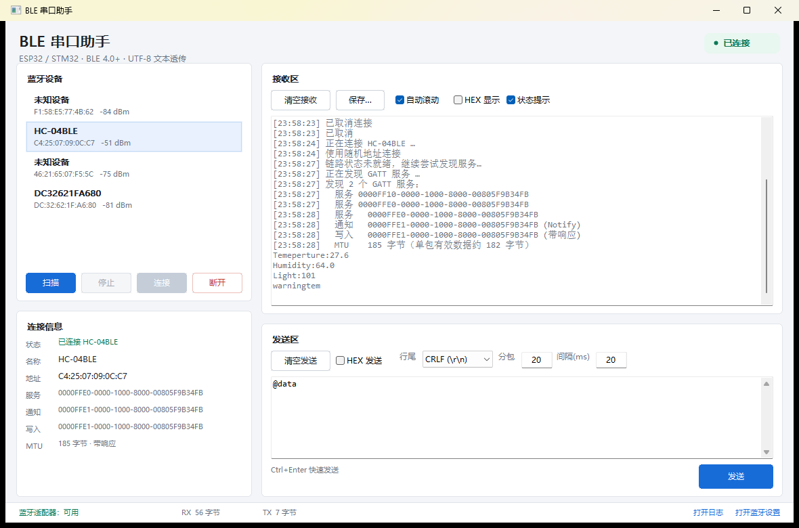
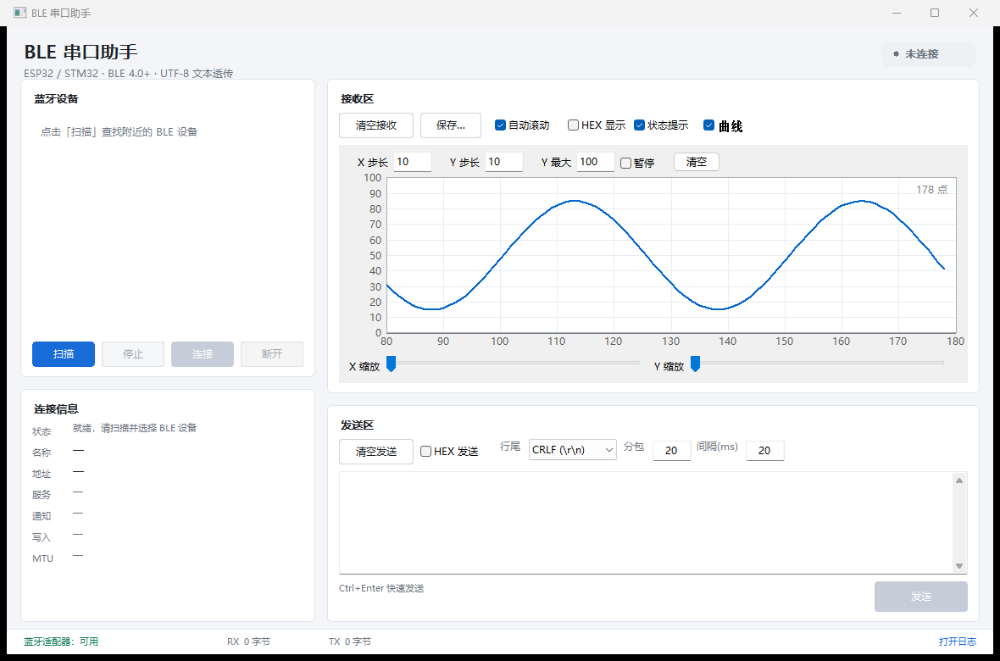

# BLE 串口助手（C 语言 · Windows 上位机）

用纯 C 编写的 BLE（低功耗蓝牙 4.0+）透传上位机：连接单片机上的 BLE（ESP32 / STM32+BLE 模块等），
接收它发来的数据，也可以把数据发回给它。界面分 **接收区**、**发送区** 和 **蓝牙信息区**，
两边都有独立的「清空」按钮，文本按 **UTF-8** 编解码。



---

## 1. 功能特性

- **扫描附近的 BLE 设备**：显示名称、MAC 地址、信号强度（RSSI），只列出可连接的广播。
- **连接 / 断开**：自动发现 GATT 服务，自动识别常见的“BLE 串口”服务：
  - Nordic UART Service（ESP32 常用）：`6E400001-…`，写 `6E400002`，通知 `6E400003`；
  - HM-10 / AT-09 / JDY-08 透传模块：`FFE0` / `FFE1`；
  - 其它自定义服务：自动选择「第一个同时具备 Notify 和 Write 特征」的服务。
- **接收区**：实时显示，支持 UTF-8 文本 / HEX 显示，自动滚动、状态提示、保存为 UTF-8 文本。
- **曲线绘图**：接收区可切换成坐标轴视图，解析 `[x,y]` 数据包实时画曲线，X 轴数据自动右移、可设步长/Y 最大值、缩放、平移、暂停。
- **快捷发送**：F1~F7 可绑定常用文本，一键发送，可开关，配置随 `settings.ini` 保存。
- **发送区**：UTF-8 文本 / HEX 发送，可选行尾（无 / CRLF / LF），可设置**分包大小**和**包间隔**，
  `Ctrl+Enter` 快速发送。
- **蓝牙信息区**：设备名称、连接状态、MAC、服务 UUID、通知特征、写入特征、MTU、读写方式。
- **收/发字节统计**，链路掉线自动检测。
- 纯 Win32 + 纯 C，无第三方运行时依赖（静态链接 CRT，单 exe 可直接运行）。

---

## 2. 系统要求

| 项目 | 要求 |
| --- | --- |
| 系统 | Windows 10 1809 及以上 / Windows 11（BLE GATT 需要 WinRT，最低 Win10） |
| 蓝牙 | 支持 BLE 4.0+ 的适配器，系统中已打开蓝牙 |
| 编译 | Visual Studio 2019/2022（“使用 C++ 的桌面开发” + Windows 10 SDK）或 CMake 3.16+ |

> 说明：BLE 不存在“波特率”。单片机端看到的 UART 波特率（如 115200）只影响 MCU 与 BLE 模块/协议栈之间，
> 空中传输由 GATT 的连接间隔、MTU、每包字节数决定。

---

## 3. 编译

### 方式一：一键脚本（推荐）

```bat
build.bat
```

生成 `build\ble_uart.exe`。脚本会用 `vswhere` 自动定位 Visual Studio，并调用 `vcvars64.bat`。

其它目标：

```bat
build.bat cli     :: 生成命令行测试程序 build\ble_cli.exe
```

### 方式二：CMake

```bat
cmake -S . -B build-cmake -G "Visual Studio 17 2022" -A x64
cmake --build build-cmake --config Release
```

### 方式三：Visual Studio

新建“Windows 桌面应用程序（C++）”空项目，加入
`src/main.c`、`src/ble.c`、`src/util.c`、`src/app.rc`，
字符集设为 Unicode，C 语言标准选 C11，链接
`user32.lib gdi32.lib comctl32.lib comdlg32.lib shell32.lib bthprops.lib runtimeobject.lib ole32.lib uuid.lib`，
编译选项加 `/utf-8`。

---

## 4. 快速开始

1. 给单片机烧录 BLE 串口固件（ESP32 可直接用 [`esp32/ble_uart_nus`](esp32/ble_uart_nus/ble_uart_nus.ino)），
   上电后开始广播。
2. 打开 `ble_uart.exe`，点 **扫描**，在左侧列表里找到设备（如 `ESP32-BLE-UART`）。
3. 选中设备，点 **连接**（或双击列表项）。
   连接成功后右上角状态变为「已连接」，下方显示服务/通知/写入特征和 MTU。
4. 在右下角输入文本，点 **发送**（或 `Ctrl+Enter`）。单片机通过 Notify 发回的数据会出现在右上角接收区。
5. 需要清空内容时，分别点接收区/发送区的 **清空接收** / **清空发送**。

> 首次连接某些设备时 Windows 可能弹出配对框；如果设备要求配对，请允许，配对后再连接。

---

## 5. 界面说明

```
┌──────────────────────────────────────────────────────────────────────┐
│  BLE 串口助手                                    ● 未连接 / 已连接   │
├───────────────────────┬──────────────────────────────────────────────┤
│  蓝牙设备             │  接收区                                      │
│  ┌─────────────────┐  │  [清空接收] [保存…] ☑自动滚动 ☐HEX ☑状态提示  │
│  │ 设备列表        │  │  ┌────────────────────────────────────────┐  │
│  │ 名称 / MAC/RSSI │  │  │ 收到的数据（UTF-8 文本或 HEX）          │  │
│  └─────────────────┘  │  └────────────────────────────────────────┘  │
│  [扫描][停止][连接][断开]                                            │
│  连接信息             │  发送区                                      │
│  状态 / 名称 / 地址   │  [清空发送] ☐HEX发送 行尾[] 分包[] 间隔[]    │
│  服务 / 通知 / 写入   │  ┌────────────────────────────────────────┐  │
│  MTU                  │  │ 要发送的内容                            │  │
│                       │  └────────────────────────────────────────┘  │
│                       │  Ctrl+Enter 快速发送              [ 发送 ]   │
├───────────────────────┴──────────────────────────────────────────────┤
│ 蓝牙适配器：可用        RX 0 字节   TX 0 字节        打开蓝牙设置    │
└──────────────────────────────────────────────────────────────────────┘
```

- **接收区工具条**
  - `清空接收`：清空显示内容（同时丢弃半个 UTF-8 字符的残留状态）。
  - `保存…`：把接收区内容保存为 UTF-8 文本文件（带 BOM，记事本/Excel 均可正常打开）。
  - `自动滚动`：新数据到达时自动滚到底部；关闭后保持当前查看位置。
  - `HEX 显示`：按十六进制显示，每行 32 字节。
  - `状态提示`：在接收区插入 `[时:分:秒] 连接/断开/扫描` 等状态行。
- **发送区工具条**
  - `HEX 发送`：把输入当作十六进制字节（空格、逗号、`0x` 前缀都可以），例如 `48 65 6C 6C 6F 0D 0A`。
  - `行尾`：文本模式自动追加 `\r\n` / `\n` / 不追加，方便单片机按行解析命令。
  - `分包`：每包最大字节数，默认 20（ATT 默认 MTU 23 − 3 字节头）。连接后可以按显示的 MTU 调整，
    例如 MTU 247 时可设为 244。
  - `间隔(ms)`：两包之间的延时。写无响应（Write Without Response）时建议 10–30 ms，避免丢包。

---

## 6. 单片机端对接

### 6.1 ESP32（Nordic UART Service）

仓库自带可直接烧录的 Arduino 示例：[`esp32/ble_uart_nus/ble_uart_nus.ino`](esp32/ble_uart_nus/ble_uart_nus.ino)。
它创建 NUS 服务，收到上位机写入的数据后原样 Notify 回显，并每秒主动发一行 `tick`。
上位机会自动识别该服务，无需任何配置。

关键点：

- TX 特征（`6E400003`）必须带 **Notify** 属性，并添加 `0x2902`（CCCD）描述符，否则上位机收不到数据；
- RX 特征（`6E400002`）带 **Write** 或 **Write Without Response**；
- 广播里建议带上服务 UUID（`addServiceUUID`），并开启 scan response，便于显示设备名。

ESP-IDF 下同理：用 `esp_ble_gatts_create_attr_tab` 建同样的服务和特征即可。

### 6.2 STM32 + HM-10 / AT-09 / JDY-08

这类模块自己完成了 BLE 协议栈，MCU 只需要把模块的 UART 当普通串口用：

```c
/* STM32 侧：USART2 接 HM-10 的 TXD/RXD，115200 8N1 */
HAL_UART_Transmit(&huart2, (uint8_t *)"hello\r\n", 7, 100);
HAL_UART_Receive_IT(&huart2, rx_byte, 1);   /* 蓝牙收到的数据从这里来 */
```

上位机会把它识别为 `FFE0/FFE1` 服务。若模块是 BLE 4.0 且出厂为 iBeacon 模式，
需要先用 AT 指令切到透传模式（如 `AT+MODE0`、`AT+NAME…`）。

### 6.3 自定义 UUID（STM32WB / 其它）

如果固件使用自定义服务，只要该服务里同时存在：

- 一个带 **Notify**（或 Indicate）属性的特征；
- 一个带 **Write** 或 **Write Without Response** 属性的特征；

上位机就会自动选中它（优先级：NUS > FFE0 > 第一个满足条件的服务）。
连接日志会把发现的所有服务 UUID 打印在接收区，便于对照。

### 6.4 数据格式建议

BLE 是字节流，没有“帧”的概念。建议在固件里约定简单帧格式，例如：

```
A5 5A | LEN(1) | CMD(1) | PAYLOAD(LEN) | CRC16(2)
```

或者直接用换行分隔的文本命令（上位机发送区选择 `CRLF` 即可），调试最方便：

```
LED ON\r\n
GET TEMP\r\n
```

---

## 7. 实现说明（为什么是纯 C）

Windows 上访问 BLE 只有 WinRT（`Windows.Devices.Bluetooth.*`）一套 API，
`bluetoothleapis.h` 里的 C 接口无法取得设备句柄，因此必须直接调用 WinRT 的 COM 接口。

- `src/winrt_abi.h`：按 Windows SDK 中 MIDL 生成的 C 版 vtable，手工声明了本项目用到的
  `IBluetoothLEAdvertisementWatcher`、`IBluetoothLEDevice`、`IGattCharacteristic`、
  `IAsyncOperation`、`IBuffer` 等接口，主程序因此可以完全用 C 编写。
- `src/ble.c`：BLE 引擎。扫描、连接、服务发现、订阅通知、写特征、收发队列都在这里。
- `src/main.c`：Win32 界面（自绘卡片、按钮、设备列表、状态栏），无 MFC/Qt 依赖。
- `src/util.c`：UTF-8 与 UTF-16 互转（容忍被 BLE 分包截断的多字节字符）、HEX 解析/格式化。

线程模型：

```
UI 线程 ──扫描/连接/发送命令──▶ BLE 引擎
   ▲                              │
   │  50ms 定时取接收数据          ├─ 扫描回调（WinRT 线程池）→ 设备表（加锁）
   └──────────────────────────────┤
                                  ├─ 连接线程：连接 + 服务发现 + 订阅（阻塞轮询异步操作）
                                  ├─ 发送线程：按“分包/间隔”逐包写特征
                                  └─ 通知回调：字节写入 64KB 环形缓冲区
```

几个容易踩的坑（已在代码中处理）：

- WinRT 的**事件委托对象以 `IUnknown` 为基类**（vtable 只有 QI/AddRef/Release + Invoke），
  不是 `IInspectable`；`QueryInterface` 只能接受 `IUnknown`、`IAgileObject` 和委托自身的参数化 IID，
  否则 COM 会按 `IMarshal` / `IAgileReference` 解析错误的 vtable。
- 异步操作通过轮询 `IAsyncInfo::get_Status` 等待，避免再实现一套 `Completed` 委托。
- 写特征用的 `IBuffer` 通过系统 `DataWriter` 生成（`WriteBytes` + `DetachBuffer`），
  保证跨公寓封送可靠；`ble.c` 里也保留了一份纯 C 的 `IBuffer` 实现作为兜底。
- 读通知数据用 `DataReader.FromBuffer()`，**不能**用 `IBufferByteAccess::Buffer()`：
  通知里的 `IBuffer` 是跨公寓代理，`Buffer()` 会返回失败（0xFFFFFFFF）甚至让
  `Windows.Devices.Bluetooth.dll` 空指针崩溃（旧版本闪退即此原因）。
- 收到的通知可能把 UTF-8 汉字截成两半，接收区会保留残留字节，拼好后再显示。

---

## 8. 常见问题

**扫描不到设备？**

- 确认系统蓝牙已打开、适配器支持 BLE（任务栏蓝牙图标 → 添加设备能看到 BLE 设备即可）；
- 设备必须处于**广播**状态（有些模块连过一次后不再广播，需要复位）；
- 本程序只显示“可连接”的广播，纯 Beacon 会被过滤；
- 距离太远（RSSI < -90）时名称可能收不到，可先靠近再扫描。

**连接失败 / 提示找不到设备（0x80070490）？**

- 设备可能已休眠、走远，或被手机/其它电脑占用（BLE 通常只允许一个中心设备连接）；
- **Windows 里有旧配对记录时也会这样**：设置 → 蓝牙和其他设备 → 找到该设备 → 删除设备，然后重新连接。
  典型场景：模块以前和这台电脑配对过，之后又用手机连过（模块只保存一份绑定），Windows 仍拿旧密钥去加密，链路会被设备拒绝；
- 有些设备使用**随机地址**并要求配对：先在 Windows「设置 → 蓝牙和其他设备」里配对，再回来连接；
- 连接期间不要同时用手机 App 连接同一设备。

**连接成功但收不到数据？**

- 固件的 TX 特征必须开启 **Notify** 并带 CCCD（`0x2902`）；只设置属性而不加 CCCD，Windows 无法订阅；
- 检查固件是否真的调用了 notify/send；
- 试试点接收区工具条的 `状态提示`，连接日志里会显示实际选中的服务/特征，确认与固件一致。

**发送失败 / 数据被截断？**

- 超过 MTU 的数据会被拆分；把「分包」设为 `MTU-3`（默认 MTU 23 时是 20）最稳妥；
- 写无响应的特征在间隔太小时容易丢包，把「间隔」调到 20–50 ms；
- 若固件只支持 Write With Response，本程序会自动使用带响应写入（连接信息里会显示）。

**中文乱码？**

- 固件发送的必须是 UTF-8 字节；GBK 会显示成 `�`，请改用 HEX 显示确认原始字节；
- 接收区关闭 `HEX 显示` 才是文本模式。

**保存的文件在 Excel 里乱码？**

- 保存的是 UTF-8（带 BOM）文本，Excel 直接双击可能按本地编码打开，请用“数据 → 从文本”选择 UTF-8。

---

## 9. 目录结构

```
ble_uart/
├─ build.bat                 一键编译脚本（MSVC）
├─ CMakeLists.txt            CMake 工程
├─ src/
│  ├─ main.c                 Win32 界面与交互
│  ├─ ble.c / ble.h          BLE 引擎（扫描/连接/GATT/收发）
│  ├─ util.c / util.h        UTF-8、HEX、UUID/地址格式化
│  ├─ winrt_abi.h            WinRT C ABI 声明
│  ├─ app.rc / app.manifest  资源、图标、DPI/控件清单
│  └─ app.ico
├─ tests/
│  └─ ble_cli.c              命令行测试（扫描/连接/发送）
├─ esp32/ble_uart_nus/       ESP32 Arduino 测试固件
├─ docs/screenshot.png
└─ tools/                    证书、签名、配对排查脚本
```

---

## 10. 已知限制

- 只支持 **BLE（GATT）**，不支持经典蓝牙 SPP / RFCOMM；
- 同一时间只连接一个设备；
- 需要 Windows 10 1809+（`BluetoothLEDevice3` / GATT 异步接口）；
- 接收环形缓冲区 64 KB，超出会丢弃并在统计中累加，长时间高速采集请及时清空或保存；
- 界面为浅色主题，未做暗色模式。

---

## 11. 代码签名（自签名证书）

仓库里附带了一张自签名代码签名证书，用于让 Windows 显示发布者名称（而不是“未知发布者 / 无验证发布者”）：

| 项目 | 值 |
| --- | --- |
| 主题 / 发布者 | `CN=WTMcccccccc` |
| 有效期 | 2026-11-04 00:00:00 ~ 2031-11-04 23:59:59 |
| 指纹 (SHA-1) | `8C227A83597C939163CAC168343AB3FA5B6CEC51` |
| 证书（公钥） | `certs/WTMcccccccc.cer` |
| 私钥 | `certs/WTMcccccccc.pfx`（密码 `ZZ20020105`） |
| 已签名程序 | `build/ble_uart.exe`（签名状态：有效） |

> `certs/*.pfx` 里是私钥，只适合本机 / 内部使用，不要提交到公开仓库或发给外部；
> `.gitignore` 已排除该文件。

### 本机信任

`tools/make_cert.ps1` 已把证书装进**当前用户**的「受信任的根证书颁发机构」和「受信任的发布者」，
所以本机右键 → 属性 → 数字签名会显示 `WTMcccccccc`，状态为“有效”。

换一台电脑时，需要安装 `certs/WTMcccccccc.cer`：

```powershell
Import-Certificate -FilePath certs\WTMcccccccc.cer -CertStoreLocation Cert:\CurrentUser\TrustedPublisher
Import-Certificate -FilePath certs\WTMcccccccc.cer -CertStoreLocation Cert:\CurrentUser\Root
```

或者双击 `.cer` → 安装证书 → 放入上述两个存储。不装的话，签名仍然存在，但 Windows 会提示“不受信任”。

### 重新签名

签名写在 PE 文件里，`build.bat` 重新编译后签名就没了，需要再签一次：

```bat
sign.bat
```

签名需要访问当前用户的私钥容器，普通桌面环境直接运行即可；在受限的沙箱/服务环境里可能报 `0x80090010`（拒绝访问）。

### 重新生成证书 / 移除信任

```powershell
# 重新生成（默认今天生效、5 年有效）
powershell -ExecutionPolicy Bypass -File tools\make_cert.ps1 -Name WTMcccccccc -Years 5

# 移除本机信任和私钥
Get-ChildItem Cert:\CurrentUser\Root, Cert:\CurrentUser\TrustedPublisher |
    Where-Object { $_.Subject -eq 'CN=WTMcccccccc' } | Remove-Item
Get-ChildItem Cert:\CurrentUser\My |
    Where-Object { $_.Subject -eq 'CN=WTMcccccccc' } | Remove-Item
```

> 自签名证书只让**装了这张证书的机器**显示发布者并认可签名，不会让别人的电脑上的 SmartScreen 直接放行。
> 对外分发建议购买正式代码签名证书（OV/EV），签名命令相同，把 `-f/-p` 换成正式证书即可。

---

## 12. 日志与崩溃排查

程序会写一份运行日志：

```text
%LOCALAPPDATA%\BLEUart\ble_uart.log
```

如果该目录不可写，会依次回退到 `%APPDATA%\BLEUart\`、`%USERPROFILE%\BLEUart\`、**exe 目录下的 `logs\`**、`%TEMP%\BLEUart\`；
回退原因会写在日志第一行。
状态栏右下角的 **「打开日志」** 可以直接打开当前日志文件。

记录内容：

- 启动/退出、DPI、窗口创建；
- 用户操作：扫描、连接（含设备名与地址类型）、断开；
- BLE 状态变化：连接中、发现服务、失败原因（GattCommunicationStatus 文字）、已连接；
- 发现的服务/特征 UUID、MTU、写入方式、发送失败原因。

崩溃时（未处理异常）：

- 日志里追加 `=== CRASH ...`，包含异常代码、出错地址、**出错模块 + 偏移**、调用栈（模块+偏移）；
- 同时写一个 minidump：`%LOCALAPPDATA%\BLEUart\crash_YYYYMMDD_HHMMSS.dmp`；
- 弹窗提示日志和 dump 的位置。

反馈问题时，把 `ble_uart.log` 和对应的 `.dmp` 一起发过来即可定位。
日志超过 2 MB 会在下次启动时清空重建。

> 如果想把 `ble_uart.exe+0x8B16` 这类偏移定位到函数，可以在链接时加 `/MAP:build\ble_uart.map`，
> 然后在地图文件里找 RVA 落在 `0x8B16` 附近的符号（等价的诊断命令，平时构建不需要）。
---

## 13. 曲线绘图（接收区）

接收区工具条勾选 **「曲线」** 即可把文本显示切换成曲线图，取消勾选回到文本；两种视图共用同一份接收数据。

**数据格式**

```text
[x,y]
```

- 支持整数/小数，例：`[12,35.5]`、`[100,88]`；
- 一个包可以跨多个 BLE 通知，解析器会自动拼接；
- 不匹配 `[...]` 的数据（比如普通调试打印）会被忽略。

**坐标轴**

- X 轴从 0 开始，没有负半轴；Y 轴同样从 0 开始；
- 左上三个输入框：`X 步长`、`Y 步长`、`Y 最大`，分别控制网格间距和 Y 轴范围；
- **X 轴不设最大值**：数据持续到来时，视图自动向右滚动，最新的点始终在右侧；
- 曲线在 X 方向回退时（例如新一轮采集从 0 重新开始）会自动断开，不会画出一条横穿全图的长线。

**缩放与平移**

- 底部 `X 缩放` / `Y 缩放` 滑块：1x ~ 50x（X 缩放改变滚动窗口的宽度）；
- 鼠标滚轮：以光标位置为中心缩放；
- 按住左键拖动：平移；
- 双击绘图区：复位到 1x 和原点。

**设置保存**

- `X 步长`、`Y 步长`、`Y 最大` 以及 X/Y 缩放会保存到日志同目录的 `settings.ini`，下次启动自动恢复；
- 修改后约 0.5 秒写入，正常关闭时也会立即保存；
- 「暂停」状态不保存。

**暂停 / 清空**

- 勾选「暂停」后不再接收新点，绘图区显示“已暂停”；取消勾选继续接收；
- 「清空」清空曲线；主界面的「清空接收」会同时清空曲线。


---

## 14. 快捷发送（F1~F7）

发送区右侧点 **「快捷…」** 打开设置窗口：

- 勾选 **启用 F1~F7 快速发送**；
- 在 F1~F7 后面填各自要发送的文本（例如 `AT+RESET`、`@data`）；
- 点「确定」保存。

启用后，在程序窗口内按 F1~F7 就会发送对应文本：

- 文本按 **UTF-8** 编码，并附加当前 **行尾** 设置（无 / CRLF / LF）；
- 使用发送区当前的分包大小和包间隔；
- 未连接时接收区会提示「快捷发送失败：尚未连接 BLE 设备」；
- 带 Ctrl / Alt 的 F 键不触发，避免误发。

配置保存在日志同目录的 `settings.ini`：

```ini
[quick]
enabled=1
f1=AT+RESET
f2=@data
...
```

重启后自动恢复；取消勾选「启用」即可关闭该功能。